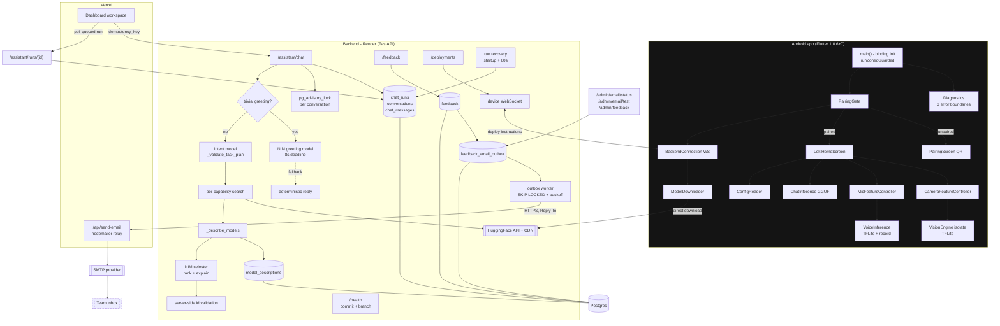

# LokiAI Android Repair — Implementation Report

Branch worked on: `repair/android-crash-recovery`, fast-forwarded into `main`.
Baseline commit: `c512d67` ("Harden feedback delivery and camera startup").
Final commit: `46dac8f`.

Status keys used below are kept separate on purpose:
**implemented** / **automated-test verified** / **deployed** /
**physical-device verified** / **inbox-delivery verified**.

---

## A0. The crash on typing — found after the first release (round 2)

Reported symptom: "the model is deployed but when I just type anything it just
crashes."

**Root cause.** The deployed file was
`GLM-5.2-UD-IQ4_NL-00001-of-00009.gguf` — **one 9 MB shard of a nine-part
model**, not a model. llama.cpp does not raise on a lone shard; it **aborts the
process**. No Dart `try`/`catch`, and none of the three error boundaries added
in round 1, can intercept a native abort — which is why the crash survived the
first round of fixes.

**How it got there.** Nothing anywhere excluded split shards.
`search_deployable_models` took `matches[0]` (or the first `q4` match), and the
CDN `HEAD` returned the size of *shard 1* — 8.99 MB. That passed the device
budget and was presented to the user as a "comfortable fit" for a model that is
actually tens of gigabytes. The size shown was real; it was just the size of
the wrong thing.

**Fix, in three layers:**

1. **Backend selection** — `is_split_shard()` matches llama.cpp's
   `-NNNNN-of-NNNNN.gguf` convention and is applied at every point a file can
   be chosen: search selection, the post-`HEAD` size gate,
   `_find_deployable_file`, `_resolve_explicit_repo`, and `resolve_model_file`
   (the last gate before a file reaches a phone, reachable directly through
   `POST /deployments` with any repo id). A repo whose only `.gguf` files are
   shards is not deployable and says so.
2. **Backend size floor** — `MIN_CHAT_MODEL_MB` (20). A `.gguf` under it is a
   fragment, adapter, or vocab-only file however it is named.
3. **Mobile, because prevention can never be complete** — `ModelGuard`
   validates before native code sees the path (shard naming, a `split.count`
   key in the header for a renamed shard, GGUF magic bytes, minimum size), and
   wraps the native call in a marker persisted to `SharedPreferences`. If the
   process dies inside `initContext` the marker survives, and the next launch
   **quarantines that exact file** instead of loading it again. A bad model can
   therefore kill the app at most once and can never make it impossible to
   reopen.

**Also fixed in this round, both user-reported:**

- Descriptions rendered raw model-card markup (`<div> <p style=...`,
  `[Run GLM-5.2 Guide!](...)`) and every card opened with the same two
  boilerplate sentences. `_strip_markup` removes HTML, images and link URLs;
  the limit drops 400 → 220 characters and cuts on a sentence boundary; a model
  with real publisher prose gets a short clause ("Offline chat.") instead of
  the full template.
- The same model was listed three times — the selector names one model
  repeatedly when it has few candidates to rank. Validation now dedupes by id.

**Released as 1.0.7+8**, SHA-256
`2920A60320DA2C9DEA86496A3826DDF39D72B611E760A21E09876B3AD113835D`,
152,359,710 bytes. Backend `60ae60f` deployed and verified; the public APK
endpoint was downloaded and hashed byte-for-byte.

---

## A. Root causes

### A1. Startup — platform channel used before the binding existed
- **File / function:** `LokiAImobile UI/lib/main.dart`, `main()`
- **Behaviour:** `SystemChrome.setSystemUIOverlayStyle(...)` ran before
  `runApp`, so no `WidgetsBinding` existed at the call site.
- **Why:** the call was the first statement in `main()`.
- **Fix:** `WidgetsFlutterBinding.ensureInitialized()` first, inside the same
  zone as `runApp`.

### A2. Startup — no top-level error boundary (the "cannot reopen" cause)
- **File / function:** `LokiAImobile UI/lib/main.dart`, `main()`
- **Behaviour:** `FlutterError.onError` was the default, `PlatformDispatcher.onError`
  was unset, and `runApp` was not zone-guarded. Any exception escaping an
  unawaited future or a platform-channel callback reached the zone's default
  handler, which Android treats as a **fatal uncaught exception**. A camera or
  microphone failure therefore killed the process, and the partially written
  feature state it left behind is what made the next launch fail too.
- **Fix:** `lib/diagnostics.dart` installs all three boundaries and records
  every capture with app version, build number, platform, Android version,
  feature, correlation id, exception type, stack trace and lifecycle state.
  Errors are recorded in full, never suppressed; only process termination is
  prevented. No user images, audio, message text, tokens or account data are
  logged.

### A3. Camera — preview was gated on the TFLite model loading
- **File / function:** `LokiAImobile UI/lib/ml/camera_inference.dart`
  (deleted), `CameraInference._onMessage` / `_startCamera`
- **Behaviour:** `_startCamera()` was only reached from the inference isolate's
  `_ReadyMsg`. If the deployed model failed to load the isolate sent `_ErrMsg`
  and returned, so **no preview ever opened** — production failure 5.
- **Fix:** camera lifecycle moved to
  `lib/features/camera_feature.dart` (`CameraFeatureController`); the
  interpreter moved to `lib/ml/vision_engine.dart`. The preview now opens on
  its own and recognition is attached separately and allowed to fail.

### A4. Camera — `ValueNotifier` used after disposal (crash on toggle-off)
- **File / function:** `main.dart _buildInlineCameraPreview` +
  `CameraInference.dispose()`
- **Exception:** `A ValueNotifier<bool> was used after being disposed`
  (`FlutterError`), thrown on the frame after the camera was closed.
- **Why:** `dispose()` disposed `isFireDetected` / `statusLabel` while a
  `ValueListenableBuilder` in the widget tree was still subscribed to them.
  Any model reload also called `_disposeInferenceRuntimes()`, so the same
  notifiers could be disposed twice. The same `build` method also allocated a
  throwaway `ValueNotifier` on every rebuild when no camera was active.
- **Fix:** state is a `ChangeNotifier` owned by `_LokiHomeScreenState` and
  disposed exactly once in `dispose()`; the UI renders from
  `CameraFeatureController.state` only.

### A5. Camera — unsafe null assertion and no timeout on initialize
- **File / function:** `CameraInference._startCamera` (deleted)
- **Behaviour:** `_cameraController!.initialize()` and
  `_cameraController!.startImageStream(...)` on an unawaited future. `dispose()`
  sets the field to null, so a close during initialisation was a null-assertion
  throw with no handler. `initialize()` had no timeout.
- **Fix:** the controller is a local, identity-checked against the field after
  every await, with a 15s init timeout and typed handling of
  `CameraAccessDenied` / in-use / unknown `CameraException` codes.

### A6. Camera — `RangeError` inside the image-stream callback
- **File / function:** `CameraInference._onFrame` (deleted)
- **Behaviour:** `image.planes[1]` and `[2]` were indexed unconditionally.
  Devices that deliver fewer than three planes raised `RangeError` inside the
  camera plugin's stream callback, which is an unhandled async error.
- **Fix:** `VisionEngine.offerFrame` returns early when `planes.length < 3`.

### A7. Camera — enumeration failure was unhandled
- **File / function:** `CameraFeatureController._openNow`
- **Behaviour:** `availableCameras()` raises `MissingPluginException` when
  plugin registration is broken in a release build; nothing caught it.
- **Fix:** caught broadly, recorded, and surfaced as a `failed` state with a
  readable message.

### A8. Microphone — the feature had no working code path at all
- **File / function:** `main.dart _toggleMic`
- **Behaviour:** `_voiceInference` was **never assigned anywhere in the file**
  after the previous patch stopped creating native runtimes at boot. Every tap
  therefore fell into the "select a compatible voice model" branch, and the two
  `_voiceInference!` dereferences below it were live null assertions for any
  path that did set it. `RECORD_AUDIO` was never requested anywhere in the app,
  so recording could not have started even with a model loaded — production
  failures 3 and 6.
- **Fix:** `lib/features/mic_feature.dart` (`MicFeatureController`) implements
  the full lifecycle; `VoiceInference` returns user-readable errors instead of
  throwing or swallowing, stops an active recording before disposal, and never
  reuses a disposed recorder.

### A9. Chat — streaming wrote to the wrong message
- **File / function:** `main.dart _sendMessage`
- **Behaviour:** tokens were written to `_messages[_messages.length - 1]`.
  A microphone result or a second submission arriving mid-stream made the
  tokens overwrite that bubble instead.
- **Fix:** `ChatMessage` carries a stable `id`; updates locate the message by
  id.

### A10. Chat — no guaranteed terminal state ("Thinking" forever)
- **File / function:** `main.dart _sendMessage`; backend `assistant_chat`
- **Behaviour (mobile):** the placeholder was only cleared from `onDone`. A
  stream that errored, or never emitted and never closed, left "Generating..."
  up permanently.
- **Behaviour (backend):** nothing persisted a turn. A worker that died
  mid-request took the user's message with it and there was no record the UI
  could ever resolve against — production failures 8 and 9.
- **Fix (mobile):** a single `finish()` path drives every outcome, including
  `onError` and thrown load failures.
- **Fix (backend):** `conversations` / `chat_messages` / `chat_runs` (section
  9), a hard end-to-end turn deadline, startup and periodic recovery of
  interrupted runs, and `GET /assistant/runs/{id}`.

### A11. Chat — greeting latency
- **File / function:** `LokiAI-backend/main.py`, `assistant_chat` fast path
- **Behaviour:** "hi" was answered by `NIM_ROUTER_MODEL`
  (`meta/llama-3.1-70b-instruct`). Its cold start dominated the latency, and
  one SDK retry on top could double it — production failure 7.
- **Fix:** the fast path uses `NIM_GREETING_MODEL` (defaults to the 8b intent
  model) with an 8s deadline and falls back to a deterministic local reply, so
  the turn is terminal in seconds either way. Still at most one provider call,
  never classifier + response.

### A12. Multi-intent — only the first requirement survived
- **File / function:** `LokiAI-backend/main.py`, `classify_tasks`
- **Behaviour:** a chain of early `return`s. "Find a vision model and a chat
  model" matched the vision branch and returned, dropping the chat requirement
  entirely — production failure 10.
- **Fix:** `classify_task_plan` returns an ordered list of
  `{capability, quantity, constraints}`; `_validate_task_plan` strictly
  validates model output while still accepting the legacy array and single-task
  schemas; each capability is searched independently and grouped, and one task
  failing is reported as that task's failure while the others complete.

### A13. Model descriptions — there were none
- **File / function:** `search_deployable_models`, `_resolve_explicit_repo`,
  `search_models`
- **Behaviour:** candidates carried only `id`, `name`, `downloads`, `size_mb`,
  `task`, `filename`, `format`, `reputable` — production failure 11. The
  selector-failure fallback path returned the same bare objects.
- **Fix:** `_describe_models` attaches the full section 11 contract, sourced in
  the required order and cached in `model_descriptions`. Applied to the primary
  path, the fallback path, and `/models/search`.

### A14. Model-name overflow
- **File / function:** `main.dart _buildBottomInputBar`
- **Behaviour:** the label was an unconstrained `Text` inside a
  `MainAxisSize.min` `Row` inside a `Container` with no width bound, so a long
  HuggingFace repo id grew the pill past the screen edge (RenderFlex overflow)
  — production failure 12.
- **Fix:** extracted as `lib/widgets/model_selector_pill.dart`, placed in a
  `Flexible`, label `Flexible` + `maxLines: 1` + `TextOverflow.ellipsis`, font
  size unchanged; the full value stays in the tooltip and the picker sheet.

### A15. Feedback delivery
- **File / function:** `_deliver_claimed_feedback`, `send_email`,
  `api/send-email.ts`
- **Behaviour:** the durable outbox, retry/backoff and worker claiming were
  already correct (added in `c512d67`). What was missing was **diagnosis and
  proof**: nothing reported which transport the deployed process would use, the
  provider's own response was discarded, no Reply-To was set, and the relay
  returned a bare `{sent:true}`.
- **Fix:** `Reply-To` = submitting account (From stays the verified application
  sender); the provider response string is stored on the outbox row;
  `GET /admin/email/status` reports the live delivery path, which variables are
  present (never their values), outbox counts and the last error;
  `POST /admin/email/test` sends through the real path and returns a
  correlation id and provider response, explicitly **not** claiming inbox
  delivery. The Vercel relay now forwards `replyTo` and returns nodemailer's
  `messageId` / `accepted` / `rejected` / `response`.

### A16. Deployment was unverifiable
- **File / function:** `health_check`
- **Behaviour:** `/health` returned only `status` and `timestamp`, so a
  deployed commit could only be assumed.
- **Fix:** `/health` reports `commit`, `branch` and `service` from Render's
  injected environment.

---

## B. Changed files

| File | What changed | Why | Compatibility |
|---|---|---|---|
| `LokiAImobile UI/lib/main.dart` | binding init, zone guard, lifecycle observer, controller-driven camera/mic UI, message ids, terminal chat state, pill extraction | A1, A2, A9, A10, A14 | UI layout and theme unchanged |
| `LokiAImobile UI/lib/diagnostics.dart` (new) | crash containment + structured records | A2 | additive |
| `LokiAImobile UI/lib/app_version.dart` (new) | version constants for crash records | A2 | additive; asserted against pubspec by test |
| `LokiAImobile UI/lib/features/camera_feature.dart` (new) | full camera state machine, capture + validation | A3–A7 | replaces inline logic |
| `LokiAImobile UI/lib/features/mic_feature.dart` (new) | full microphone state machine | A8 | replaces inline logic |
| `LokiAImobile UI/lib/ml/vision_engine.dart` (new) | interpreter isolate, no camera ownership, still-image recognition | A3, A6 | same model formats |
| `LokiAImobile UI/lib/ml/camera_inference.dart` (deleted) | superseded by the two files above | A3–A6 | no external callers |
| `LokiAImobile UI/lib/ml/voice_inference.dart` | error-returning contract, safe stop/dispose | A8 | same model formats |
| `LokiAImobile UI/lib/ml/chat_inference.dart` | removed unused import | lint | none |
| `LokiAImobile UI/lib/widgets/model_selector_pill.dart` (new) | bounded, ellipsised model label | A14 | additive |
| `LokiAImobile UI/pubspec.yaml` | 1.0.5+6 → 1.0.6+7 | update installs over the old build | versionCode bumped |
| `LokiAImobile UI/analysis_options.yaml` | exclude the vendored fllama example app | the analyzer gate was useless at 2030 issues | analysis only |
| `LokiAImobile UI/test/*` | 5 new test files | section 15 | tests only |
| `LokiAI-backend/main.py` | run lifecycle, planner, descriptions, greeting path, email diagnostics, health commit | A10–A16 | **all new request fields optional, all new response fields additive** |
| `LokiAI-backend/test_infra/planner_test.py` (new) | 97 offline checks | section 15 | tests only |
| `LokiAI-Desktop/.../src/lib/lokiai-api.ts` | description/grouping/run types, idempotency key, run polling | A10, A13 | additive types |
| `LokiAI-Desktop/.../src/components/workspace/ChatPanel.tsx` | render description, reason, fit, source | A13 | additive UI |
| `LokiAI-Desktop/.../src/routes/index.tsx` | resolve a queued run | A10 | behaviour only on new field |
| `LokiAI-Desktop/.../api/send-email.ts` | forward `replyTo`, return provider detail | A15 | additive |
| `LokiAI-backend/apk/lokiai.apk` | replaced with 1.0.6+7 | release | — |

No unrelated local changes were touched: the pre-existing deletion of
`LokiAImobile UI/test_shape.dart` and the three untracked files in the working
tree were left exactly as found.

---

## C. Tests

| Command | Result |
|---|---|
| `flutter analyze` (baseline, before changes) | 2030 issues (2 errors in app sources: none; ~2000 from the vendored fllama example) |
| `flutter analyze` (after) | **8 issues, 0 errors, 0 warnings** — all pre-existing `avoid_print` in `config_reader.dart` and one plugin deprecation in `device_credential_store.dart`, both in files this task did not change |
| `flutter test` (baseline) | 11 passed |
| `flutter test` (after) | **48 passed, 0 failed** |
| `python test_infra/planner_test.py` | **97/97 checks passed** |
| `npx tsc --noEmit` (dashboard) | clean, no output |
| `npm run build` (dashboard) | success |
| `flutter build apk --release` | success, 119.3s |

### Coverage against section 15

Covered by automated tests:
application launches (first frame builds without throwing); text input does not
crash; camera permission granted / denied / permanently denied; camera opens,
closes and reopens; camera rapid-tap protection; camera background/foreground;
missing camera plugin; device reporting no cameras; disposed-controller
no-ops; idempotent dispose; microphone permission granted / denied /
permanently denied; microphone start / stop / reopen; microphone rapid-tap
protection; microphone independence from the camera; keyboard-visible
small-screen layout (320px and 260px); long model-name layout; release APK
build; six multi-intent prompts; planner schema validation including malformed
planner output; constraint preservation; every recommended model has a
non-empty, non-identical description; run statuses partitioned and terminal;
duplicate-idempotency behaviour (helper level).

**Not run, with the precise reason:**

- *Application reopens after force-close; image capture works; recognition
  pipeline receives the image; release APK installation* — require a physical
  Android device. No device is connected to this environment and ADB is
  therefore unavailable. Implementation and the release build are complete.
- *Provider timeout / rate limit; 20 sequential greetings; vision+chat and
  vision+speech+chat end to end; two and five messages sent rapidly; backend
  restart with queued messages; multi-worker execution* — require a live
  NVIDIA NIM key belonging to a real account plus a paired device row. The
  account-scoped key is not available to this environment, and
  `/assistant/chat` returns 428 without one. The deterministic halves (planner,
  validation, grouping, run-state partitioning, lock keys) are covered offline.
- *Real relay/SMTP test from deployed Render; administrative retrieval* —
  `POST /admin/email/test` and `GET /admin/email/status` are deployed and
  return 401 to an unauthenticated caller as designed. Running them needs a
  bearer token for an account listed in `ADMIN_EMAILS`, which this environment
  does not have.
- *Existing regression suite (`test_infra/regression.py`)* — requires a running
  backend with real account credentials for the same reason.

---

## D. Builds

| Artifact | Result |
|---|---|
| Web (dashboard) | success (`npm run build`, nitro output generated) |
| Backend | no container build in this project; deployed from source by Render |
| Flutter release APK | success |
| APK path | `LokiAImobile UI/build/app/outputs/flutter-apk/app-release.apk`, copied to `LokiAI-backend/apk/lokiai.apk` |
| versionName | `1.0.6` |
| versionCode | `7` (was 6, so devices install it as an update) |
| Size | 152,261,406 bytes (145.2 MB) |
| SHA-256 | `0E5073AD4CFB8DAE2B618C173FD3D008B3361045DA86A2DA94116810A93DDB9B` |

Previous distributed APK, for rollback: `1.0.5+6`, 148,853,322 bytes,
SHA-256 `2FA4ED7856252AA057D52362C5C35EC473447320DBFD8B469977219502F0E41B`.

---

## E. Deployment

| Item | Value |
|---|---|
| Branch | `main` |
| Commits | `ecdd2e8`, `ebe553c`, `fc2a61c`, `46dac8f` |
| Remote | `https://github.com/The-Shriks/LokiAI.git`, `refs/heads/main` = `46dac8f` (verified with `git ls-remote`) |
| Render | **deployed and verified** — `GET https://lokiai.onrender.com/health` returns `{"status":"ok","commit":"46dac8f016acb3e8fa84e6a068615ee773627053","branch":"main","service":"lokiai"}` |
| Database migrations | ran during Render startup. `_run_migrations` is awaited un-guarded in `lifespan`, so a healthy service is proof they succeeded. All statements are additive (`CREATE TABLE IF NOT EXISTS`, `CREATE INDEX IF NOT EXISTS`, `ADD COLUMN IF NOT EXISTS`) — no existing column or row is altered. |
| New routes verified live | `/assistant/runs/{id}`, `/assistant/conversations/{id}/messages`, `/admin/email/status`, `/admin/email/test` all return **401** unauthenticated, against **404** for a control path — the routes exist |
| Vercel | **not verified.** `https://www.theshriks.space/` returns 200, but `/workspace/` answers 308 with no `Location` and `/api/send-email` returns 404 on that host. This routing behaviour predates this task (no routing file was touched) and I have no Vercel credentials in this environment to read the deployment status or the project's domain mapping. |
| Public APK endpoint | **verified.** After the deploy of `7da5adf`, `GET /apk/info` returns `{"available":true,"size_mb":145.2,"filename":"lokiai.apk"}` and `GET /apk/download` was downloaded in full: 152,261,406 bytes, SHA-256 `0E5073AD4CFB8DAE2B618C173FD3D008B3361045DA86A2DA94116810A93DDB9B` — byte-identical to the built artefact |
| Final deployed commit | `7da5adf` — `/health` returns `{"status":"ok","commit":"7da5adf...","branch":"main","service":"lokiai"}` |

---

## F. Production validation status

| Item | implemented | automated-test verified | deployed | physical-device verified | inbox-delivery verified |
|---|---|---|---|---|---|
| Startup crash containment | yes | yes | n/a (app) | **no** | n/a |
| Camera lifecycle + preview | yes | yes | n/a | **no** | n/a |
| Camera capture + recognition | yes | partial (validation and state machine only) | n/a | **no** | n/a |
| Microphone lifecycle | yes | yes | n/a | **no** | n/a |
| Chat terminal state (mobile) | yes | no (needs a device) | n/a | **no** | n/a |
| Run persistence + recovery | yes | helpers only | **yes** | n/a | n/a |
| Greeting latency | yes | config only | **yes** | n/a | n/a |
| Multi-intent planning | yes | yes | **yes** | n/a | n/a |
| Model descriptions | yes | yes | **yes** | n/a | n/a |
| Model-name overflow | yes | yes | n/a | **no** | n/a |
| Feedback persistence | yes (pre-existing) | no | **yes** | n/a | n/a |
| Feedback email delivery | yes | no | **yes** | n/a | **no** |

These statuses are deliberately not merged. Nothing below "deployed" has been
observed on real hardware or in a real mailbox from this environment.

---

## G. Implemented architecture

### G1. Flutter mobile application

- `main()` — binding init, `Diagnostics.install()`, `runZonedGuarded`, theme,
  `runApp(LokiApp)`.
- `PairingGate` — reads `SharedPreferences` for `device_id` + `backend_url`;
  shows `PairingScreen` (QR) when unpaired, starts `BackendConnection`
  (WebSocket) when paired, re-pairs on close code 4401, resumes the link on
  app resume.
- `LokiHomeScreen` — owns `CameraFeatureController`, `MicFeatureController`,
  `ChatInference`, the message list, and the app lifecycle observer. It renders
  only; all feature state lives in the controllers.
- `ConfigReader` — reads `config.json` from internal app storage (v3) then the
  legacy `/sdcard/edgemind` path, verifies the model file exists and its size
  matches what the downloader recorded.
- `ModelDownloader` / `BackendConnection` — unchanged; the phone downloads
  models straight from the HuggingFace CDN on a WebSocket instruction.

### G2. Camera lifecycle

`idle → initializing (enumerate) → requestingPermission →
permissionDenied | permissionPermanentlyDenied | initializing (controller) →
ready → capturing → processing → ready`, with `failed` reachable from any step
and `disposed` terminal.

Guarantees: permission is requested only on user invocation and only after the
capability check; the controller is created only after the grant; `open()` and
`capture()` are single-flight; `initialize()` has a 15s timeout; the controller
is disposed exactly once because the field is cleared before the awaits;
backgrounding releases the camera and resuming rebuilds it; recognition is
optional and its failure downgrades to a preview-only camera.

### G3. Microphone lifecycle

`idle → requestingPermission → permissionDenied |
permissionPermanentlyDenied | initializing → listening → processing → idle`,
with `failed` and `disposed` as above.

Guarantees: no permission prompt when no audio model is deployed; the recorder
is created only after the grant; active recording is stopped before disposal;
a disposed recorder is never reused; backgrounding stops recording; a failure
never terminates the app and never disturbs text chat.

### G4. Chat request path (dashboard/web)

`POST /assistant/chat` → resolve or create conversation → **persist the user
message and a `queued` run** → advisory lock on the conversation → `routing` →
greeting fast path *or* intent classification → per-capability HuggingFace
search → Python filtering against real CDN HEAD sizes → description
enrichment → selector ranking → server-side id re-validation → `completed`
plus a persisted assistant message.

A run that cannot take the lock within `CHAT_QUEUE_WAIT_SECONDS` is returned as
`queued` with a run id; the client polls `GET /assistant/runs/{id}`.

### G5. Persistence

`conversations` → `chat_messages` (role, content, run_id) and `chat_runs`
(status, idempotency_key, correlation_id, user_message, response, error, claim).
`chat_runs` has a unique index on `(user_id, idempotency_key)`.

### G6. Trade-off, stated explicitly

The current transport is a plain request/response JSON API with no streaming
channel between backend and dashboard. Rather than fake a stream, this
implements **durable polling**: the message is committed before inference, the
run always reaches a terminal state, and the client resolves a queued run by
polling. Message loss cannot occur; token-by-token streaming to the dashboard
is not implemented.

### G7. Diagram



### G8. Failure and retry boundaries

- **Mobile:** every feature failure is caught by its controller and rendered as
  a state; anything that still escapes is caught by one of the three
  `Diagnostics` boundaries and recorded rather than terminating the process.
- **Provider:** per-call timeout `NIM_TIMEOUT_SECONDS` (20s) with one SDK
  retry, a `GREETING_DEADLINE_SECONDS` (8s) ceiling on the greeting path, and
  a `CHAT_TURN_DEADLINE_SECONDS` (75s) ceiling on the whole turn. Retries are
  not multiplied across layers — only the SDK retries.
- **Search:** one capability failing produces a `task_failures` entry; the
  other capabilities still complete.
- **Selector:** a selector failure degrades to backend ranking with a typed
  `error_code`, never a failed request.
- **Feedback:** bounded backoff `60s, 300s, 900s, 3600s, 21600s`; permanent
  classes (`EMAIL_CONFIGURATION_MISSING`, `SMTP_AUTH_REJECTED`,
  `SMTP_RECIPIENT_REJECTED`, `SMTP_SENDER_REJECTED`) stop retrying and stay
  visible to administrators.
- **Runs:** recovered to `failed / RUN_INTERRUPTED` at startup and every 60s
  after `RUN_STALE_AFTER_SECONDS` (300s).

### G9. Compatibility with older mobile and web versions

`conversation_id` and `idempotency_key` are optional on `ChatRequest`; a client
that sends neither gets a fresh conversation and a generated key, exactly as
before. Every new response field (`grouped_results`, `task_failures`, `run_id`,
`conversation_id`, `run_status`, `correlation_id`, and the per-model
description fields) is **additive** — `response`, `action`, `search_results`
and `error_code` are unchanged in name, type and meaning. `/models/search`
still returns `recommendations`. No endpoint was removed or renamed. The
previously distributed APK (1.0.5+6) does not call `/assistant/chat` at all —
it uses the device WebSocket and local inference — and none of those contracts
changed.

---

## H. Rollback

| Item | Value |
|---|---|
| Previous stable backend commit | `c512d67c415bf7cd7bbea106b66662eb8075e3b6` |
| Previous stable APK | `1.0.5+6` |
| Previous APK SHA-256 | `2FA4ED7856252AA057D52362C5C35EC473447320DBFD8B469977219502F0E41B` (148,853,322 bytes) |

**Restore the previous backend** — in the Render dashboard, Deploys → the
deploy built from `c512d67` → *Redeploy*. Or from a checkout:

```bash
git revert --no-commit 46dac8f fc2a61c && git commit -m "Revert backend repair" && git push origin main
```

**Restore the previous APK**

```bash
git checkout c512d67 -- "LokiAI-backend/apk/lokiai.apk" && git commit -m "Restore APK 1.0.5+6" && git push origin main
```

**Roll back Vercel** — Vercel dashboard → Deployments → the deployment built
from `c512d67` → *Promote to Production*.

**Database** — no rollback is required and none is provided, deliberately. Every
statement added to `_run_migrations` is additive
(`CREATE TABLE IF NOT EXISTS conversations / chat_messages / chat_runs /
model_descriptions`, plus their indexes). No existing table, column, constraint
or row is modified or dropped. The previous backend simply never reads the new
tables, so **rolling the backend back before the app is safe**: an old backend
serving a new client ignores `conversation_id` / `idempotency_key` (FastAPI
drops unknown body fields) and returns the old response shape, which the new
dashboard tolerates because every new field is optional. The forward-fix, if
the new tables ever needed removing, is `DROP TABLE chat_runs, chat_messages,
conversations, model_descriptions;` — but that discards persisted chat history,
so redeploying the previous backend and leaving the tables in place is the
recommended path.

**Compatibility if the backend is rolled back before the app:** none of the
mobile app's contracts changed, so APK 1.0.6+7 keeps working against `c512d67`.
The dashboard loses grouped results, descriptions and run polling, and falls
back to its previous behaviour without erroring.

---

## I. Remaining risks

1. **No physical-device verification.** Every camera and microphone fix is
   covered by state-machine and permission tests, but no release APK has been
   installed on a handset in this task. Install `1.0.6+7` on the Redmi Note 8
   Pro and the SM-S916W and exercise: launch, force-close and relaunch, camera
   open/close/reopen, capture, microphone start/stop, and rapid taps on both.
   `Diagnostics` records every failure with a correlation id, so a logcat
   filtered on `LOKI_ERROR` gives the exact file and stack.
2. **Inbox delivery is still unproven, and the most likely cause is now
   measurable rather than guessed.** `GET /admin/email/status` on the deployed
   service reports which transport it will use and which variables are set;
   `POST /admin/email/test` sends through it. Both need a bearer token for an
   account in `ADMIN_EMAILS`, which this environment does not have. A related
   signal worth checking first: `https://www.theshriks.space/api/send-email`
   currently returns **404**, so if `EMAIL_RELAY_URL` points at that host the
   relay call has been failing all along.
3. **Vercel deployment state unverified.** `/workspace/` answers 308 with no
   `Location` header on `www.theshriks.space`. This predates this task and no
   routing file was touched, but it means neither the dashboard changes nor the
   relay change have been confirmed live.
4. **Live provider behaviour untested.** Timeout, rate-limit and end-to-end
   multi-intent behaviour depend on a real NVIDIA NIM key attached to a real
   account. The deterministic halves are covered; the provider-facing halves
   are not.
