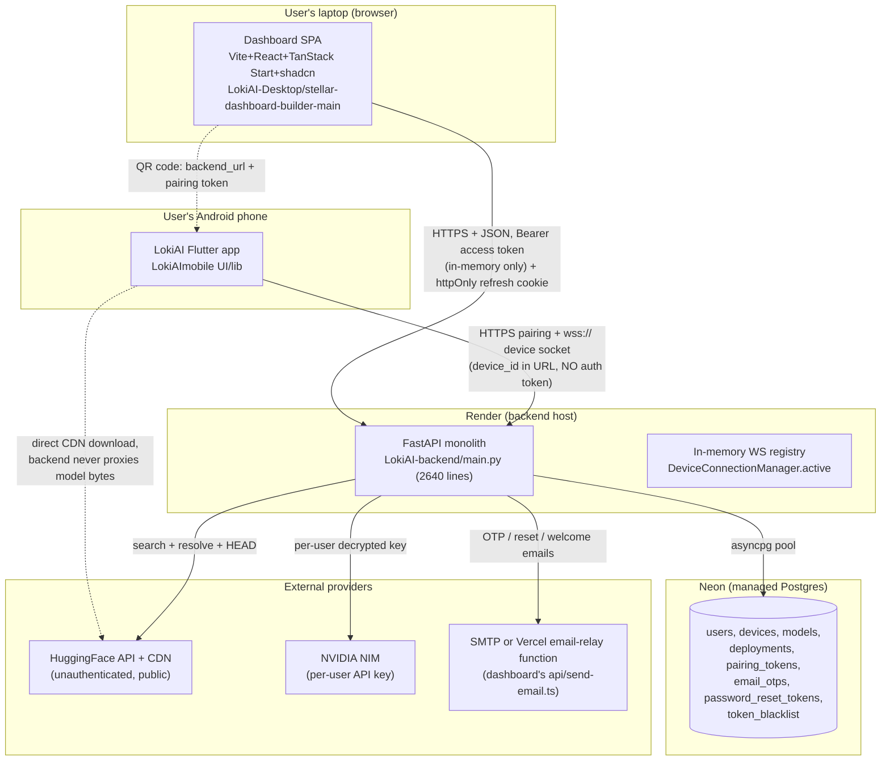
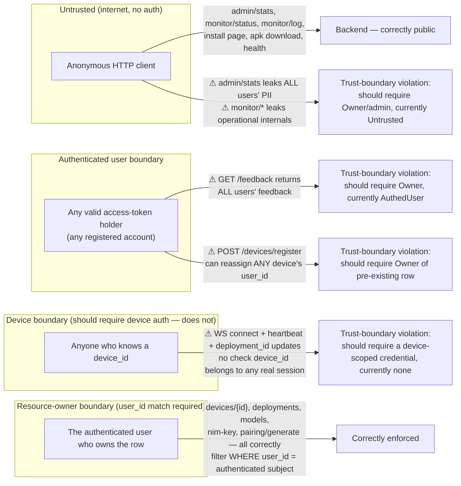

# LokiAI — Deep Audit (Phase 0 + Phase 1)

**Date:** 2026-07-27
**Auditor:** Claude (Sonnet 5), per `ANTIGRAVITY_LOKIAI_DEEP_AUDIT_AND_IMPLEMENTATION_PROMPT.md`
**Scope:** Full repository at `L:\The Shriks\LokiAI` — backend, dashboard, mobile app, database, docs.
**Method:** Static reading of `LokiAI-backend/main.py` in full (2640 lines, 7 sequential reads), live read-only introspection of the production Postgres schema (`information_schema`, `pg_indexes`, `pg_constraint` — table/column/index/FK metadata only, zero row data read), two parallel Explore-agent audits (frontend dashboard, Flutter mobile app) whose claims were spot-checked against source and cross-referenced against each other and against the backend read. No code was modified during this pass. No live HTTP calls were made against the production backend or database beyond the two read-only schema-introspection scripts below.

No changes have been made to the repository in this pass. This document, `LOKIAI_IMPLEMENTATION_PLAN.md`, `LOKIAI_SECURITY_THREAT_MODEL.md`, `LOKIAI_TEST_AND_CHANGE_AUDIT.md`, and `LOKIAI_PRODUCTION_RUNBOOK.md` are the only new files.

---

## 0. Repository baseline

- **Root:** `L:\The Shriks\LokiAI`, git repo, branch `main`, HEAD `168f79b8d3cc538ddd8655ee911e5820011b81ac`.
- **Working tree at audit start:** two untracked files — `ANTIGRAVITY_LOKIAI_DEEP_AUDIT_AND_IMPLEMENTATION_PROMPT.md` (this directive) and `patch.py` (stale one-off script, see Defect P2-8). No modified tracked files, nothing stashed, nothing to lose.
- **Remote:** `origin` → `https://github.com/The-Shriks/LokiAI.git`.
- **No fix branch was created** — this pass is audit-only, no code was touched, so there is nothing to branch for yet. A fix branch should be created before Batch 1 of the implementation plan.
- **Runtime:** Python 3.14.6 (backend venv), FastAPI 0.137.1, asyncpg 0.31.0, PostgreSQL (Neon, per `.env.example` comments — memory records say Railway; the live comments and retry-logic docstrings in `main.py:110-115` confirm the actual current provider is **Neon**, with Render as the compute host — both docs and old memory are stale on this point).
- **Hosting (confirmed from code, not docs):** backend on **Render** (`RENDER` env var check, `onrender.com` Host-header checks, free-tier SMTP-block workaround in `main.py:433-459`); dashboard on **Vercel** (`lokiai-v11.vercel.app` hardcoded fallback, `main.py:1119`). The `Docs/01_ARCHITECTURE.md` source-of-truth doc still says "Railway free tier" and "Next.js 14" — **both are stale**; the real stack is Render + Neon + Vite/React/TanStack Start, not Railway + Next.js. This document supersedes those two claims; the doc itself should be updated for future agents (P2 recommendation, not fixed in this pass per "do not silently change" — flagging only).
- **No CI/CD exists** — no `.github/workflows` or equivalent found anywhere in the repo.
- **No automated test suite exists** — `LokiAI-backend/*.py` test-named files (`test_phase1.py`, `test_phase3_e2e.py`, `test_task3_1.py` … `test_task3_4.py`, `verify_phase3.py`) are standalone scripts that POST directly against `http://localhost:8000` with hardcoded/throwaway emails (e.g. `e2e_user3@example.com`) and a **live** database connection (via `.env`). They are not wired to `pytest`, not isolated, not idempotent (several would fail on second run against unique-constraint columns), and not run by anything automatically. **Baseline test result: not executed in this pass** — running them would create real rows in the production Neon database and was judged out of scope for a read-only audit without explicit user sign-off. This is itself a Phase 0 gap: there is no safe, repeatable way to establish a green baseline right now. See `LOKIAI_IMPLEMENTATION_PLAN.md` Batch 0.
- **Secrets inventory (presence only, values never read or printed):** `LokiAI-backend/.env` exists and is gitignored (confirmed via `.gitignore`); `.env.example` documents the expected keys: `DATABASE_URL`, `JWT_SECRET_KEY`, `NVIDIA_API_KEY`, `SMTP_*`, `EMAIL_RELAY_URL`/`EMAIL_RELAY_SECRET`, `CORS_ALLOWED_ORIGINS`, `DASHBOARD_URL`, `BACKEND_PUBLIC_URL`, `APK_DOWNLOAD_URL`/`APK_SIZE_MB`. No secret values were read, printed, or logged during this audit.
- **Stray root-level artifacts** not part of the shipped app: `Adobe Express - file.png`, `edgemind_screen.png`, `lokiai_screen*.png`, `pairing_qr.png`, `qwen1_5-0_5b-chat-q4_0.gguf` (395MB), `smollm2-135m-q4.gguf` (105MB), `dummy_model.tflite`, `verify_phase1.py`, `verify_phase4.py`, `accept_licenses.py`, `extract_adb.py`/`extract_go.py`/`download_extract_go.py`, `camera_config.json`/`chat_config.json`/`voice_config.json`/`test_config.json`, `go/`, `platform-tools/`, `.pub-cache/`. These are leftovers from earlier (pre-v3, ADB-based) architecture iterations per `06_RULES.md`'s "components that no longer exist" table. Not security-relevant on their own (not served by any route), but they bloat the repo (~500MB of committed/untracked binary model files) and are candidates for cleanup — flagged as P2, not touched in this pass.

---

## 1. Architecture map

**What's real vs. documented-but-gone:** the v3 wireless flow (QR pairing → `/devices/pair` → WebSocket → backend pushes a `deploy` instruction with a raw HuggingFace CDN URL → phone downloads directly) is real and is what `POST /deployments` actually does. A second, entirely separate and **dead** ADB-based deployment pipeline (`run_deployment`, `push_to_device`, `adb_shell`, `install_apk`) still exists in `main.py` (lines 2134–2371) — it is never called by any route, but it's real, uncommented-out, `subprocess`-invoking code sitting in the same file, contradicting `Docs/06_RULES.md` Rule 12 ("No USB, No ADB… if you find yourself writing adb commands, you are doing it wrong"). See Defect P1-6.

---

## 2. Trust boundaries

The intended model (per the controlling directive) is four concentric boundaries: **Untrusted → Authenticated user → Device (its own credential) → Resource owner**. Section 2's diagram shows where the real code currently collapses a boundary — four confirmed collapses, detailed as P0 defects below.

---

## 3. Database ownership map (live schema, introspected read-only)

All five core tables plus three auth-support tables exist in the live Neon database. **None of the core tables (`users`, `devices`, `models`, `deployments`, `pairing_tokens`) have a `CREATE TABLE` statement anywhere in the repository** — only the three later-added tables (`email_otps`, `password_reset_tokens`, `token_blacklist`) and incremental `ALTER TABLE ... ADD COLUMN IF NOT EXISTS` calls exist, inside `_run_migrations()` (`main.py:49-107`), which runs unconditionally on every boot. The core schema must have been created out-of-band (a one-off script or console session) and is **not reproducible from a clean clone**. See Defect P2-9.

| Table | Owner column | FK → | Unique constraints | Indexes beyond PK |
|---|---|---|---|---|
| `users` | — (root) | — | `email` | none |
| `devices` | `user_id` | `users.id` (unindexed FK) | `adb_serial` | none — **`user_id` has no index** |
| `models` | `user_id` | `users.id` (unindexed FK) | none | none — **`user_id` has no index** |
| `deployments` | `user_id` | `users.id`, `devices.id`, `models.id` (all unindexed FKs) | none | none — **`user_id`/`device_id` have no index** |
| `pairing_tokens` | `user_id` | `users.id` (unindexed FK) | `token` | none |
| `email_otps` | `user_id` | `users.id` (unindexed FK) | none | none |
| `password_reset_tokens` | `user_id` | `users.id` (unindexed FK) | none | none |
| `token_blacklist` | — | — (jti is the PK) | — | PK on `jti` (sufficient) |

Every tenant-scoped query in the app is a `WHERE user_id = $1::uuid` (or joins through `device_id`/`model_id`) against an unindexed column — see Defect P1-9.

**Ownership enforcement (confirmed correct):** `GET/DELETE /devices/{id}`, `GET /models`, `GET/POST /deployments`, `PUT/DELETE /auth/nim-key`, `POST /models/search`, `POST /assistant/chat` all correctly scope their `WHERE` clause to the authenticated `user_id` from `get_current_user`, never a client-supplied id. This is the majority of the app and it is done right. The confirmed exceptions are enumerated in Section 5.

---

## 4. API inventory (all 34 HTTP routes + 1 WebSocket route)

| Method/Path | Auth | Ownership check | Rate limit | Notes |
|---|---|---|---|---|
| `GET /health` | none | — | — | fine, public |
| `GET /monitor/status` | **none** | — | — | ⚠ P0-3 |
| `GET /monitor/log` | **none** | — | — | ⚠ P0-3 |
| `POST /feedback` | token | — (any user) | none | fine to accept, see GET below |
| `GET /feedback` | token | **none (all users' data)** | none | ⚠ P0-2 |
| `GET/HEAD /apk` (legacy) | none | — | — | dead/duplicate of `/apk/download`, P2-10 |
| `GET /install` | none | — | — | fine, public onboarding page |
| `POST /auth/register` | none | — | 3/min (IP) | fine |
| `POST /auth/verify-otp` | none | — | **none** | mitigated by 5-attempt-per-OTP cap; no IP throttle |
| `POST /auth/resend-otp` | none | — | 60s cooldown (in-function) | fine |
| `POST /auth/login` | none | — | 5/min (IP) | fine |
| `POST /auth/refresh` | refresh cookie | — | none | rotates + blacklists old jti, correct |
| `POST /auth/logout` | bearer (optional) + cookie | — | none | fine |
| `GET /auth/me` | token | self | none | ⚠ P0-6 — crashes; would leak raw key if "fixed" naively |
| `PUT /auth/nim-key` | token | self | 10/min | fine |
| `DELETE /auth/nim-key` | token | self | none | fine |
| `POST /auth/forgot-password` | none | — | 3/min (IP) | fine, enumeration-safe |
| `POST /auth/reset-password` | none (token in body) | token-scoped | none | fine, single-use + `FOR UPDATE` |
| `GET /apk/download` | none | — | — | fine, public |
| `GET /apk/info` | none | — | — | fine, public |
| `GET /system/info` | none | — | — | fine, public (LAN/URL discovery only) |
| `POST /pairing/generate` | token | self | none | fine |
| `POST /devices/pair` | pairing token (body) | token-scoped, single-use | none | fine |
| `GET /devices/{id}` | token | self | none | fine |
| `POST /devices/register` | token | **none — can hijack any device by adb_serial** | none | ⚠ P0-5, also dead-flow legacy |
| `GET /devices` | token | self | none | fine |
| `DELETE /devices/{id}` | token | self | none | fine |
| `POST /models/search` | token | self (device) | **none** | ⚠ P1-8, expensive, unthrottled |
| `GET /models/files/{name}` | none | — (public download link) | — | fine — `basename()` strips traversal |
| `GET /models` | token | self | none | fine |
| `POST /models/upload` | token | self | **none, and exempt from body-size cap** | ⚠ P0-8 |
| `POST /assistant/chat` | token | self | 20/min (per-user) | fine rate-limit; error handling is P1-7 |
| `WS /ws/device/{device_id}` | **none** | **none** | — | ⚠ P0-4 |
| `POST /deployments` | token | self (device) | **none** | ⚠ P1-8 |
| `GET /deployments` | token | self | — | fine |
| `GET /deployments/{id}` | token | self (DB fallback path only — in-memory path below) | — | see note |
| `GET /admin/stats` | **none** | **none — dumps every user** | — | ⚠ P0-1, most severe finding |

Note on `GET /deployments/{id}`: the fast path (`deployment_id in deployment_status`, `main.py:2561-2565`) returns the in-memory status dict **without checking `user_id` at all** — only the DB-fallback path (`main.py:2568-2581`) filters by owner. Since `deployment_status` is populated for every deployment created by any user (it's one shared process-global dict keyed only by `deployment_id`), **any authenticated user who can guess/enumerate a UUID `deployment_id` gets that deployment's live status/progress/error_message for free, cross-account**, as long as it's still "hot" in memory (not yet fallen through to DB-only). This was found during API-inventory cross-checking after the two agent audits returned; folded into Defect P0-2's family below as P0-2b since it's the same class of bug (missing ownership filter) at a second location.

---

## 5. WebSocket protocol map

`WS /ws/device/{device_id}` (`main.py:2088-2121`):

- **Connect:** client opens `wss://<backend>/ws/device/<device_id>` with **no Authorization header, no token, no signed claim** — confirmed independently from both the backend handler and the Flutter client (`lib/backend_connection.dart:62-67`, per mobile audit). The server calls `ws_manager.connect(device_id, websocket)` immediately, which just does `self.active[device_id] = websocket` — no lookup against the `devices` table, no check the caller ever paired, no check the device isn't already connected elsewhere.
- **Server → client messages:** `{"type": "connected", ...}` on connect; `{"type": "heartbeat_ack", ...}` in reply to a heartbeat; `{"action": "deploy", "deployment_id", "model_url", "model_name", "model_sha256", "config"}` pushed by `POST /deployments`.
- **Client → server messages:** `{"type": "heartbeat", ...}` (refreshes `devices.status='connected'` + `last_seen`); or any dict containing `deployment_id` (routed to `_handle_deployment_update`, which writes `deployments.status/progress/error_message` for **whatever `deployment_id` is in the message**, with no check it belongs to `device_id`'s owner or even to `device_id` at all).
- **Disconnect:** `WebSocketDisconnect` → `ws_manager.disconnect()` + `devices.status='offline'`. **A non-clean disconnect (process kill, network black-hole, backend crash/restart) never reaches this path** — `ws_manager.active` is a plain in-memory dict with no TTL/expiry sweep, and a Render restart wipes it instantly while leaving `devices.status` in the DB exactly as it was before the restart (stale "connected").
- **Duplicate connections:** a second `connect()` call for the same `device_id` silently replaces the dict entry; the first socket object is never explicitly closed server-side.

This is the single biggest gap between the current implementation and the directive's Section E requirements (authenticated socket, heartbeat TTL, generation/session id, duplicate arbitration, reconnect reconciliation) — essentially none of Section E's required controls exist yet on the server side.

---

## 6. Frontend state / cache map

(Full detail in the frontend agent's findings, spot-checked; summarized here.)

- **Access token:** in-memory module variable only (`lokiai-api.ts`), never localStorage/sessionStorage — this is correct, deliberate XSS hardening.
- **Refresh token:** httpOnly cookie, never touched by JS — correct.
- **TanStack Query is installed and provider-wrapped but genuinely unused** — zero `useQuery`/`useMutation` calls anywhere. All data fetching is manual `useEffect`+`fetch`. There is therefore no query-cache cross-account collision risk, but also no real caching/dedup layer despite the dependency being present — dead scaffolding (P2-11).
- **Chat sessions:** `localStorage["lokiai_chat_sessions_v1_<user_id>"]`, correctly scoped by the real authenticated UUID going forward. **One confirmed narrow leak:** a one-time migration path silently assigns any pre-existing *unscoped* legacy key to whichever user happens to log in first after the scoping change shipped (P1-10).
- **Workspace panel layout** (`lokiai_workspace_layout_v1`/`_open_v1`) is **not** user-scoped (low-sensitivity UI prefs only — which panels are open — not user content) (P2-12).
- **Logout:** clears the in-memory token, best-effort revokes server-side, unmounts route state via SPA navigation. No explicit `AbortController` cancellation of in-flight requests exists, but in practice React's unmount-on-navigate makes this a non-issue today; flagged as a latent gap for whenever a real WS/query-cache layer is added (P2-13).
- **No WebSocket is opened by the dashboard at all** — device/deployment "real-time" status is 100% polling (multiple uncoordinated 5s/2s/1.5s `setInterval` loops across `index.tsx`, `devices.tsx`, `models.tsx`, `ChatPanel.tsx`, `monitor.tsx`, `admin.tsx`), all using `cache: "no-store"`. This contradicts the directive's assumption that the frontend binds a WS for device status — it doesn't; it polls. Wasteful (redundant identical `GET /devices` calls from multiple mounted components) but not incorrect (P2-14).
- **XSS:** clean. No markdown rendering, no `dangerouslySetInnerHTML` on any user/LLM-sourced content (the one use of it, in the shadcn `ChartStyle` helper, only ever receives developer-authored theme tokens).
- **Deploy authorization:** clean, already matches the directive's required pattern — the backend returns a typed `search_results: ModelRecommendation[]` array separate from the free-text `response` string; the frontend never parses `[DEPLOY_BUTTON: ...]`-style magic strings out of LLM prose. Nothing to fix here.
- **Duplicate-deploy guard:** present and well-reasoned on the actual deploy path (checks `deployStates[rec.id]` status before allowing a second submit, explicitly to protect real in-flight progress from being clobbered by a second call's 409). Other, lower-stakes forms use plain `disabled={busy}`, adequate but not bulletproof against pathological double-click timing — low severity.

---

## 7. Mobile lifecycle / reconnect map

(Full detail in the mobile agent's findings, spot-checked; summarized here.)

- **Pairing credential:** `device_id` persisted in plain `shared_preferences` (unencrypted, backup-eligible — no `flutter_secure_storage`, no `android:allowBackup="false"`). The one-time pairing *token* itself is not persisted (already consumed), so the durable secret is just `device_id` — which, per the P0-4 WS-auth gap, is also the *only* thing needed to impersonate the device.
- **WebSocket reconnect:** fixed 5-second delay, no exponential backoff, no jitter, hard-stops permanently after 30 attempts (~2.5 minutes) with nothing to resume it short of an app relaunch.
- **Heartbeat:** client sends one every 20s; server acks are received but never checked — a half-open TCP connection (no clean FIN) would not be detected via missing acks, only via the OS socket layer eventually erroring out.
- **App lifecycle:** **zero** `WidgetsBindingObserver`/`AppLifecycleState` handling exists anywhere in the Flutter codebase — confirmed via full-tree grep returning no matches. Foreground/resume never re-verifies network, never forces a reconnect, never re-sends the device profile, never reconciles pending deployments. This is the direct, confirmed root cause of the reported "phone can remain shown offline after the device is turned back on" symptom: nothing on the client side re-triggers reconnection on resume, and the fixed-backoff/30-attempt-cap reconnect loop (previous bullet) may already have permanently given up by the time the user looks at the phone again.
- **Download integrity:** SHA-256 verified against `model_sha256` when the backend supplies it, atomic `.part`→final rename on success — solid design. **Verification is silently skipped if the backend omits `model_sha256`** (it does for arbitrary `model_url` deployments — `main.py:2453-2455` sets `model_sha256 = None` for direct-URL deploys). No HTTP `Range` resume — every retry restarts the download from byte 0.
- **Path handling:** `model_name` from the server's `deploy` message is concatenated directly into a filesystem path with no sanitization (no `..`/separator/null-byte stripping) before being used as both the download destination and the value later written into local `config.json`'s `model_path`. Combined with the unauthenticated WS channel, this is a real (if currently theoretical, requiring a malicious/compromised backend or a MITM) path-traversal vector within the app's own sandboxed storage.
- **Desired-vs-actual reconciliation:** the app is purely reactive — it never proactively tells the backend "here is what I actually have deployed right now" on connect/reconnect. After any missed WS message (offline window, backend restart, etc.) the two sides can silently diverge with no self-healing mechanism.
- **Cold-start/crash recovery:** this one works correctly — `PairingGate.initState()` re-reads persisted `device_id`/`backend_url` and calls `BackendConnection.instance.start()` automatically on every app launch, no manual re-pair needed, undermined only by the reconnect-loop's permanent-give-up behavior above if the very first post-launch attempt sequence exhausts its budget before the network/backend is reachable.

---

## 8. Ranked defect register

Severity follows the controlling directive's P0/P1/P2 scheme exactly.

### P0 — cross-tenant leakage, secret exposure, broken authz, identity takeover, exploitable DoS

| # | Defect | Evidence | Root cause |
|---|---|---|---|
| **P0-1** | `GET /admin/stats` has zero authentication and returns every user's id/name/email/created_at/email_verified/device_count/last_active/latest_deployment to any anonymous caller. | `main.py:2583-2586` (no `Depends`, code comment explicitly admits it: *"In a real production app, we would secure this with an admin role"*). Frontend `admin.tsx` also has no client-side auth guard (unlike every other protected route). | Endpoint was built as a "local admin dashboard" and never gated before being deployed to the public internet. |
| **P0-2** | `GET /feedback` requires only *any* valid token (not ownership/admin) and returns every user's feedback submissions including their email. `GET /deployments/{id}`'s in-memory fast path also skips the ownership filter that its own DB-fallback path applies. | `main.py:371-376` (`get_feedback`); `main.py:2558-2565` vs. `2568-2581` (inconsistent filtering between the two code paths of the same handler). | Missing `WHERE user = current_user` filter in one path; a second handler applies it inconsistently between its two internal branches. |
| **P0-3** | `GET /monitor/status` and `GET /monitor/log` require no authentication and expose aggregate user/device/deployment counts plus up to 500 recent request-log entries (method, path, status, latency, and raw exception text on error) to any internet caller. | `main.py:288-307`. | Built as an internal ops tool, deployed public with no auth. |
| **P0-4** | `WS /ws/device/{device_id}` accepts any `device_id` with zero authentication — no token, no ownership check, no verification the caller ever paired. Enables: reading pushed deployment instructions meant for another user's device; forging heartbeats to fake presence; forging `deployment_id` progress updates that overwrite **any** deployment's status/progress/error, cross-account, if the id is known/guessed. | `main.py:2088-2121` (`device_websocket`, `ws_manager.connect`, `_handle_deployment_update`). Independently confirmed from the client side: mobile app sends no credential over the socket either (`lib/backend_connection.dart:32-67`, per mobile audit). | WebSocket upgrade never validates identity against the `devices` table or any per-connection credential — matches the directive's explicit "pairing or WebSocket identity takeover" P0 category verbatim. |
| **P0-5** | `POST /devices/register` upserts on the globally-unique `adb_serial` and reassigns `user_id = EXCLUDED.user_id` on conflict with no check on the pre-existing row's owner — any authenticated user who knows/guesses another device's `adb_serial` can claim it into their own account in one call. | `main.py:1253-1278`, `ON CONFLICT (adb_serial) DO UPDATE SET user_id = EXCLUDED.user_id`. | Legacy v2 (ADB) registration endpoint, superseded by `/devices/pair`'s token-scoped flow, but never removed or gated — still live and reachable. Directly contradicts `Docs/06_RULES.md` Rule 12 ("No USB, No ADB"). |
| **P0-6** | `GET /auth/me` calls `_decrypt_key(...)`, a function that is **never defined anywhere in main.py** (only `_decrypt_secret` exists) — guaranteed `NameError` → 500 for every user who has saved a NIM key. This is the change introduced by the most recent commit, `168f79b`, whose *intent* — return the raw decrypted NIM key to the client for display in a revealable password field — independently violates the controlling directive's non-negotiable secret-handling rules regardless of whether the crash is fixed. | `main.py:891`; confirmed via `grep -n "def _decrypt"` returning only `_decrypt_secret` (line 46); `git show 168f79b` diff on both `main.py` and `LokiAI-Desktop/.../src/routes/account.tsx` / `lokiai-api.ts`. `getMe()` (the function that calls this endpoint) is invoked from `Sidebar.tsx`, `ChatPanel.tsx`, `panels.tsx`, `account.tsx`, and `index.tsx` — i.e. nearly every screen in the app — so this is very likely a live production outage for any user who has ever configured a NIM key (required to use the assistant at all). | Undefined-name typo shipped in the last commit; the *feature itself* (plaintext key round-trip to the browser) also needs a product decision, not just a bug fix — see "Needs your decision" below. |
| **P0-7** | `allow_origin_regex=r"https://.*\.vercel\.app\|..."` combined with `allow_credentials=True` and a production `SameSite=None; Secure` refresh cookie means **any** attacker-controlled `*.vercel.app` deployment (free, self-service, anyone can create one) can issue a credentialed cross-origin `fetch()` to `/auth/refresh` from a victim's browser and receive a fresh access token in the response — full session takeover without needing any XSS on the LokiAI origin itself. | `main.py:179` (CORS config); `main.py:656-665` (`_set_refresh_cookie`, `samesite="none" if is_https else "lax"`). | Wildcard-trusting an entire public PaaS subdomain instead of an explicit allowlist of the project's own known dashboard origin(s). |
| **P0-8** | `POST /models/upload` is explicitly exempted from the 10MB body-size cap (`_BODY_SIZE_EXEMPT_PATHS = ("/models/upload",)`) and has no rate limit — any authenticated user can repeatedly upload unbounded-size files, exhausting server disk (`uploaded_models/`). | `main.py:200-217`, `1595-1649`. | Body-size exemption was added to support real large model files but was not paired with any quota/rate-limit/per-user-storage-cap control. |

### P1 — reliability, correctness, unbounded resource use, presence/reconnect

| # | Defect | Evidence |
|---|---|---|
| P1-1 | No typed NIM error taxonomy — every provider failure (timeout, invalid key, rate limit, malformed JSON) falls into one `except Exception as e` → `HTTPException(502, f"...{e}")`, leaking raw provider/SDK exception text to the client. The `428` "key missing" case is handled cleanly; nothing else is. | `main.py:1844-1868`, `1976-1992` |
| P1-2 | `POST /models/search` and `POST /deployments` have no rate limit at all (only `/assistant/chat` does). `POST /auth/verify-otp` has no endpoint-level rate limit either (mitigated by the per-OTP 5-attempt cap, but not by any IP/account throttle on the endpoint itself). | route table in Section 4 |
| P1-3 | Device presence has no server-side TTL/heartbeat-expiry sweep — a non-clean disconnect (process kill, black-holed network, backend restart) never flips `devices.status` away from `"connected"`. A Render restart wipes the in-memory `ws_manager.active` dict instantly while the DB `status` column stays stale from before the restart. This is a confirmed, code-level root cause candidate for the reported "phone shown offline/online incorrectly" symptom, compounding with the mobile reconnect gap in P1-6. | `main.py:2013-2121` (no expiry logic anywhere in `DeviceConnectionManager`) |
| P1-4 | Duplicate WebSocket connections for the same `device_id` silently overwrite `ws_manager.active[device_id]` with no explicit close of the superseded socket and no arbitration. | `main.py:2017-2019` |
| P1-5 | No index on any of the six tenant-scoped FK columns (`devices.user_id`, `deployments.user_id`, `deployments.device_id`, `models.user_id`, `pairing_tokens.user_id`, `email_otps.user_id`) — confirmed via live `pg_indexes` read. Every `WHERE user_id = $1` query is a sequential scan. | live schema introspection, Section 3 |
| P1-6 | Mobile WebSocket reconnect uses a fixed 5s delay (no exponential backoff/jitter) and permanently stops after 30 attempts with no lifecycle hook to resume it. No `AppLifecycleState`/`WidgetsBindingObserver` exists anywhere in the Flutter app — confirmed root cause of stale-offline-after-resume. | `LokiAImobile UI/lib/backend_connection.dart:26-28, 105-124`; full-tree grep for lifecycle APIs, zero matches |
| P1-7 | Mobile app never reports its actual local deployment/runtime state back to the backend on connect/reconnect — purely reactive to pushed `deploy` instructions, no desired-vs-actual reconciliation. | `LokiAImobile UI/lib/backend_connection.dart:147-164` |
| P1-8 | `model_name`/`filename` from the server's WS `deploy` payload is used unsanitized in on-device filesystem paths (download destination and `config.json`'s recorded `model_path`) — path-traversal risk given the WS channel itself is unauthenticated (P0-4). | `LokiAImobile UI/lib/model_downloader.dart:20, 88, 92` |
| P1-9 | Dead ADB-based deployment pipeline (`run_deployment`, `push_to_device`, `adb_shell`, `install_apk`, `check_apk_installed`, `_resolve_adb_path`) — ~250 lines, zero call sites, `subprocess`-invoking, contradicts the documented v3 architecture. Not independently exploitable today (unreachable from any route) but latent risk if ever casually re-wired. | `main.py:2134-2371`; confirmed via `grep -n "run_deployment("` returning only the `def`, no call sites |

### P2 — maintainability, performance polish, documentation drift

| # | Defect | Evidence |
|---|---|---|
| P2-9 | Core schema (`users`, `devices`, `models`, `deployments`, `pairing_tokens`) has no in-repo creation script — only later incremental `ALTER`/`CREATE IF NOT EXISTS` patches. Not reproducible from a clean clone. | Section 3 |
| P2-10 | Duplicate/overlapping APK-serving routes: `/apk`+`/install` (old, references `LokiAImobile UI/build/...`) vs. `/apk/download`+`/apk/info` (current, references `LokiAI-backend/apk/lokiai.apk`). | `main.py:568-626` vs. `1080-1101` |
| P2-11 | TanStack Query installed and provider-wrapped, entirely unused (zero `useQuery`/`useMutation` calls) — dead scaffolding that could mislead a future contributor into assuming a caching contract exists. | frontend audit, Section 6 |
| P2-12 | Workspace panel-layout localStorage keys are not user-scoped (low-sensitivity UI prefs only). | `Workspace.tsx:35-36, 42, 80` |
| P2-13 | No `AbortController`-based request cancellation on logout; currently masked by React's unmount-on-navigate, will become a real bug the moment a real WS/query-cache layer is added. | `Sidebar.tsx:51-53` |
| P2-14 | Multiple uncoordinated 5s/2s/1.5s polling loops across the dashboard independently re-fetch `GET /devices`; no shared cache/dedup despite TanStack Query being present unused. `handleSend` also serially awaits `getDevices()` before `assistantChat()` on every message, an avoidable round trip. | Section 6, frontend audit §5/§10 |
| P2-15 | No CI/CD pipeline; test scripts are ad hoc, mutate the live production database, and are not runnable in isolation. | Section 0 |
| P2-16 | `patch.py` (untracked, root) is a stale one-off script whose target regex no longer matches current `main.py` (its intended changes were already independently implemented differently in later commits — confirmed by reading the current `_public_base_url`/`system_info` functions against `patch.py`'s regex patterns). Harmless if left un-run, but undocumented and directly mutates `main.py` if executed. | `patch.py` vs. `main.py:1059-1128` |
| P2-17 | `Docs/01_ARCHITECTURE.md` still describes Railway + Next.js 14; the real stack (confirmed from code) is Render + Vercel + Vite/React/TanStack Start. Source-of-truth doc is stale. | Section 0 |

---

## 9. Items that audited clean (do not touch)

To avoid over-fixing: the following were specifically checked against directive requirements and found already correct — no action needed, listed so they aren't accidentally "fixed" into a regression:

- Access-token-in-memory + httpOnly-cookie refresh pattern (frontend).
- Deploy action typing — no `[DEPLOY_BUTTON]`-style string parsing anywhere; fully typed `search_results` payload separate from LLM prose.
- XSS surface — no markdown rendering, no unsafe `dangerouslySetInnerHTML` on user/LLM content.
- Password reset — single-use, hashed, `FOR UPDATE`-locked, enumeration-safe generic response.
- OTP verification — hashed, expiring, attempt-capped, cooldown on resend.
- JWT — short-lived access (30 min) + rotated refresh (7 day) + real revocation via `token_blacklist`, `jti`+`type` claims checked.
- `/models/files/{name}` — `os.path.basename()` correctly strips path-traversal attempts.
- HuggingFace search — bounded parallel `asyncio.gather`, not unbounded fan-out; correctly excludes non-runnable formats (`.safetensors`/`.bin`/`.onnx`) and "uncensored" merges by default.
- Server-side re-validation of every NIM-selector-returned model id against the real filtered candidate list before trusting it (`main.py:1995-2002`) — matches the directive's "deterministic backend owns the transport JSON" requirement well.
- Duplicate-deploy guard on the actual deploy button path (checks in-flight status before allowing resubmission).
- Mobile download integrity — SHA-256 verify + atomic `.part`→rename (when `model_sha256` is supplied).
- Mobile cold-start/crash recovery — automatic re-pair-free reconnection on every launch.

---

## 10. Needs your decision before any fix (do not implement without explicit sign-off)

**P0-6 (`/auth/me` NIM key exposure)** is the one finding where "fix the bug" and "follow the directive" point in opposite directions from what the last commit intended:

- The **crash** (`NameError` on `_decrypt_key`) is unambiguous and safe to fix — but the only way to "restore intended behavior" as the commit wrote it is to also restore the exact behavior (returning the raw decrypted key to the browser) that the controlling directive's Rule 8 / Section A / Section H forbid without exception ("Never... serialize NVIDIA NIM keys... API-key read endpoints return only configured status... never return the original key").
- I have **not** touched this file. Two real options exist and only you can pick:
  1. **Directive-compliant fix (recommended):** `/auth/me` goes back to returning only `has_nim_key: bool` (status only, never the value); the Account Settings "Eye" toggle either gets removed or is repurposed to reveal a value the user just typed into the save field in the current session (never a value fetched from the server). This restores a working `/auth/me` for every user immediately.
  2. **Keep the reveal feature as designed:** wire `_decrypt_key` → `_decrypt_secret` so it actually runs. This fixes the crash but knowingly ships a documented P0-severity secret-exposure path (the key would traverse the network, land in a JSON response body, and sit in React component state / browser memory / potentially devtools network logs on every Account Settings page load).

I've written Batch 1 in `LOKIAI_IMPLEMENTATION_PLAN.md` for option 1 since it's the only one consistent with the controlling directive, but will not apply it without your go-ahead given it reverses your own most recent explicit commit.

---

*Continued in `LOKIAI_IMPLEMENTATION_PLAN.md` (ordered work packages), `LOKIAI_SECURITY_THREAT_MODEL.md` (assets/actors/attack paths), `LOKIAI_TEST_AND_CHANGE_AUDIT.md` (append-only work log), and `LOKIAI_PRODUCTION_RUNBOOK.md` (operational procedures).*
